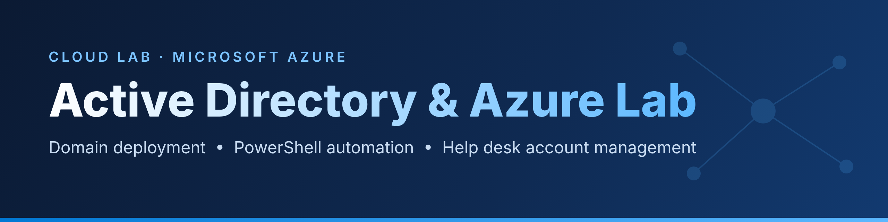

# On-Premises Active Directory Deployed in the Cloud (Azure)

This tutorial walks through deploying on-premises Active Directory inside Azure virtual machines and performing everyday help desk account tasks. I build a domain controller and a client, join the client to the domain, organize the domain with OUs and a security group, create users in bulk with PowerShell, configure an account lockout policy with Group Policy, and then unlock an account and reset its password.

## Languages Used

- PowerShell

## Environments and Technologies Used

- Microsoft Azure (Virtual Machines/Compute, Virtual Networks)
- Remote Desktop
- Active Directory Domain Services
- Active Directory Users and Computers (ADUC)
- Group Policy Management
- DNS
- PowerShell

## Operating Systems Used

- Windows Server 2025 Datacenter
- Windows 11 Pro (25H2)

## High-Level Deployment and Configuration Steps

1. Create the domain controller VM (DC-1), its resource group, and its virtual network, then set its private IP to static
2. Create the client VM (Client-1) on the same network and point its DNS to DC-1
3. Allow ping on DC-1 and test connectivity from Client-1
4. Install Active Directory Domain Services and promote DC-1 to a domain controller
5. Create organizational units and a domain admin account
6. Join Client-1 to the domain
7. Allow domain users to use Remote Desktop on Client-1
8. Create a security group
9. Create users in bulk with PowerShell
10. Configure an account lockout policy with Group Policy
11. Lock out an account, then unlock it and reset the password

## Deployment and Configuration Steps

### Step 1: Create the domain controller (DC-1)

1. In the Azure portal, search for **Virtual machines** and click **Create** > **Azure virtual machine**.
2. On the **Basics** tab, enter these settings:
   - Resource group: click **Create new** and name it `AD-Lab`
   - Virtual machine name: `DC-1`
   - Region: **(US) East US 2**
   - Availability zone: **Zone 1**
   - Image: **Windows Server 2025 Datacenter: Azure Edition**
   - Size: **Standard_D2ls_v7** (2 vCPUs, 4 GiB memory)
   - Username: `labuser`, with a password of my choice

3. On the **Networking** tab, Azure creates a new virtual network (`vnet-eastus2-1`) and subnet (`snet-eastus2-1`, 172.16.0.0/24) for the lab. Click **Review + create**, then **Create**.

4. When deployment finishes, open DC-1 and go to **Networking** > click the network interface > **IP configurations** > **ipconfig1**.
5. Change the private IP allocation from **Dynamic** to **Static** and click **Save**. DC-1's private IP is `172.16.0.4`.

*Why this matters:* every computer on the domain finds the domain controller by its IP address. If the address changed, logins would fail across the network.

### Step 2: Create the client (Client-1) and point its DNS to DC-1

1. Create a second VM with these settings:
   - Resource group: `AD-Lab` (the existing one)
   - Virtual machine name: `Client-1`
   - Region: **(US) East US 2**, Availability zone: **Zone 1**
   - Image: **Windows 11 Pro, version 25H2**
   - Size: **Standard_D2ls_v7**
   - Username: `labuser`, with the same password as DC-1

2. On the **Networking** tab, select DC-1's virtual network **vnet-eastus2-1** and subnet **snet-eastus2-1**. Azure defaults to creating a new network here, so this has to be changed by hand (see the troubleshooting note in Step 6). Click **Review + create**, then **Create**.

3. When deployment finishes, open Client-1 and go to **Networking** > click the network interface > **DNS servers**.
4. Select **Custom**, enter DC-1's private IP `172.16.0.4`, and click **Save**.

5. Restart Client-1 from the Azure portal so it picks up the new DNS setting.

*Why this matters:* a computer finds its domain through DNS. Wrong DNS settings are one of the most common reasons a domain join fails.

### Step 3: Allow ping on DC-1 and test connectivity

1. Copy DC-1's public IP address and connect to it with **Remote Desktop** as `labuser`.
2. On DC-1, run `wf.msc` (Windows Defender Firewall with Advanced Security). Under **Inbound Rules**, enable both **Core Networking Diagnostics – ICMP Echo Request (ICMPv4-In)** rules so DC-1 answers ping requests.

3. Connect to Client-1 with Remote Desktop and open Command Prompt.
4. Run `ping 172.16.0.4`. The replies confirm Client-1 can reach DC-1.

5. Run `ipconfig` to confirm Client-1 has its own address (`172.16.0.5`), then `nslookup mydomain.com` to confirm DC-1 answers DNS queries. (This screenshot was taken after Active Directory was installed in Step 4, which is when `mydomain.com` exists.)

### Step 4: Install Active Directory and promote DC-1

1. On DC-1, open **Server Manager** and click **Manage** > **Add Roles and Features**.
2. Click **Next** until **Server Roles**, check **Active Directory Domain Services**, click **Add Features**, then click **Next** and **Install**.

3. When the install finishes, click the **flag icon** at the top of Server Manager and select **Promote this server to a domain controller**.

4. Select **Add a new forest** and enter `mydomain.com` as the root domain name.

5. On **Domain Controller Options**, leave **Domain Name System (DNS) server** checked so DNS is installed along with Active Directory, and set a Directory Services Restore Mode (DSRM) password.

6. Leave **Create DNS delegation** unchecked (there's no parent DNS zone in this lab), click **Next** through the remaining pages, and click **Install**. DC-1 restarts automatically. The first restart as a domain controller takes several minutes.
7. Reconnect to DC-1 using the domain account `mydomain.com\labuser`. Running `whoami` confirms the login is now a domain account.

*Why this matters:* this turns a regular server into the central system that controls who can log in and what they can access.

### Step 5: Create OUs and a domain admin account

1. Open **Active Directory Users and Computers** from Server Manager > **Tools**.
2. Right-click `mydomain.com` > **New** > **Organizational Unit**. Create four OUs: `_EMPLOYEES`, `_ADMINS`, `_CLIENTS`, and `_GROUPS`.

3. Right-click `_ADMINS` > **New** > **User**. Create **Jane Doe** with the logon name `jane_admin`. Because this is a lab, I unchecked **User must change password at next logon**.

4. Right-click Jane Doe > **Properties** > **Member Of** > **Add**. Type `Domain Admins`, click **Check Names**, then **OK**, **Apply**, and **OK**.

*Troubleshooting:* my first login as Jane failed with an error saying the account wasn't allowed to log in remotely. When I checked her **Member Of** tab, only Domain Users was listed, so the Domain Admins membership hadn't saved. I added it again and clicked **Apply** and **OK** before closing the window, and the login worked.

5. Sign out of DC-1 and log back in as `mydomain.com\jane_admin`. I use this account for the rest of the lab.

*Why this matters:* separating admins, employees, and computers into OUs lets you apply different policies to each, and using a named admin account instead of the built-in one makes admin activity easier to audit.

### Step 6: Join Client-1 to the domain

1. Connect to Client-1 as the local admin (`labuser`).
2. Press **Win + R**, run `sysdm.cpl`, and click **Change** on the **Computer Name** tab.
3. Under **Member of**, select **Domain**, type `mydomain.com`, and click **OK**.
4. When prompted, enter the `mydomain.com\jane_admin` credentials. A "Welcome to the mydomain.com domain" message confirms the join. Restart Client-1.

**Troubleshooting the domain join:** my first attempts failed. Here's how I worked through it.

- The join failed with an error saying a domain controller for the domain could not be contacted. The details showed that the DNS lookup for the domain controller's record had failed.

- On Client-1, `ipconfig /all` showed the correct DNS server and `ping 172.16.0.4` got replies, but `nslookup mydomain.com` got no response from the server.

- On DC-1, the DNS service was running and answered queries locally, so I turned off the Windows Firewall on DC-1 to rule it out. Turning the firewall off is only acceptable because this is an isolated lab; in production I would open the required ports (DNS, Kerberos, LDAP) instead.

- The join still failed. Running `Test-NetConnection 172.16.0.4 -Port 53` on Client-1 showed the source address was also `172.16.0.4`, meaning Client-1 had the same IP as DC-1. In Azure, Client-1's network interface was on **vnet-eastus2-2**, a second virtual network the VM wizard had created with the same address range. The two VMs were on separate networks, and Client-1's earlier pings had been answering itself.

- **Fix:** Azure can't move an existing VM to a different virtual network, so I deleted Client-1 and the extra virtual network, then rebuilt Client-1 on **vnet-eastus2-1** (shown in Step 2). Client-1 then got its own address (`172.16.0.5`), `nslookup mydomain.com` returned DC-1, and the domain join succeeded.

5. On DC-1, open ADUC and confirm Client-1 appears in the **Computers** container. Drag it into the `_CLIENTS` OU.

### Step 7: Allow domain users to use Remote Desktop on Client-1

1. Connect to Client-1 as `mydomain.com\jane_admin`.
2. Run `sysdm.cpl`, open the **Remote** tab, and click **Select Users**.
3. Click **Add**, type `Domain Users`, click **Check Names**, then **OK**.

*Why this matters:* by default only admins can log in remotely. This lets normal employee accounts sign in to Client-1, which I need to test the lockout policy in Step 11.

### Step 8: Create a security group

1. On DC-1, in ADUC, right-click `_GROUPS` > **New** > **Group**.
2. Name the group `ACCOUNTANTS`, leave the scope as **Global** and the type as **Security**, and click **OK**.

*Why this matters:* permissions are assigned to groups instead of individual users. When someone joins or leaves a team, the help desk only changes their group membership.

### Step 9: Create users in bulk with PowerShell

1. On DC-1, right-click **PowerShell ISE** and select **Run as administrator**.
2. Create a new file, paste in the course's user-creation script, and save it as `create-users.ps1`. I set `$NUMBER_OF_ACCOUNTS_TO_CREATE` to `100`.
3. Click **Run**. The script generates random names and creates each account in the `_EMPLOYEES` OU with `New-ADUser`.

4. In ADUC, click `_EMPLOYEES` and press **F5** to confirm the new accounts appear.

5. Log in to Client-1 as one of the new users (`mydomain.com\gugu.kalibi`) to confirm the account works.

*Note:* the script gives every user the same password and sets passwords to never expire. That's fine for a lab, but in production I would avoid both. Step 11 shows how the never-expire setting gets in the way of a normal password reset.

### Step 10: Configure an account lockout policy

1. On DC-1, run `gpmc.msc` to open **Group Policy Management**.
2. Expand **Forest: mydomain.com** > **Domains** > `mydomain.com`, right-click **Default Domain Policy**, and click **Edit**.
3. Go to **Computer Configuration** > **Policies** > **Windows Settings** > **Security Settings** > **Account Policies** > **Account Lockout Policy**.
4. Set these values:
   - Account lockout threshold: **5** invalid logon attempts
   - Account lockout duration: **30** minutes
   - Reset account lockout counter after: **30** minutes

5. On Client-1, open Command Prompt as administrator and run `gpupdate /force` so the new policy applies right away.

*Why this matters:* lockout policies stop attackers from guessing passwords over and over.

### Step 11: Lock out an account, then unlock it and reset the password

1. From Remote Desktop, try to log in to Client-1 as `mydomain.com\gugu.kalibi` with the wrong password more than 5 times until the account locks.

2. On DC-1, in ADUC, right-click `mydomain.com` > **Find**, search for `gugu.kalibi`, and click **Find Now**.

*Tip:* ADUC only lists the first 2,000 objects in a container, so in a real domain with thousands of users, **Find** is the fastest way to locate an account.

3. Open the account, go to the **Account** tab, check **Unlock account**, and click **Apply**.

4. Right-click the user > **Reset Password**. Enter a new temporary password and check **User must change password at next logon**.

5. On the **Account** tab, both **User must change password at next logon** and **Password never expires** were checked, because the user-creation script set passwords to never expire. When I applied the change, Windows warned that the user would not be required to change their password.

6. I unchecked **Password never expires**, left **User must change password at next logon** checked, and clicked **Apply**.

7. Connecting to Client-1 as gugu.kalibi with the temporary password now returns a message that the password must be changed before logging on, which confirms the reset is working. Remote Desktop checks credentials before the Windows login screen appears, so it shows this message instead of a password change prompt.

*Why this matters:* forcing a password change at the next logon means the help desk never knows the user's final password. Always verify the caller's identity before unlocking or resetting an account, since attackers often call help desks pretending to be users.
